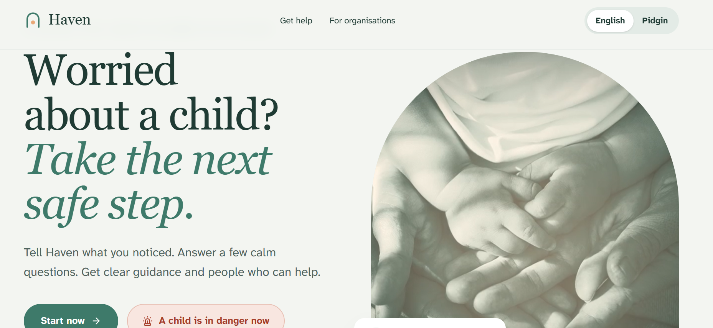
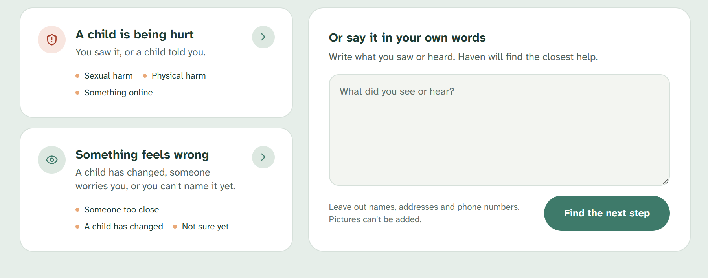
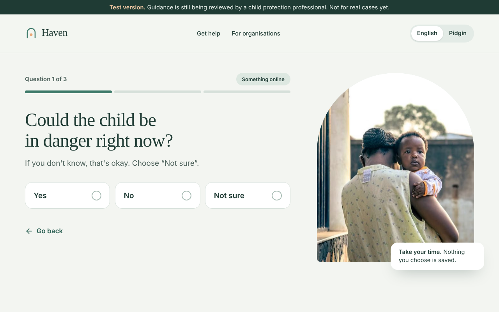
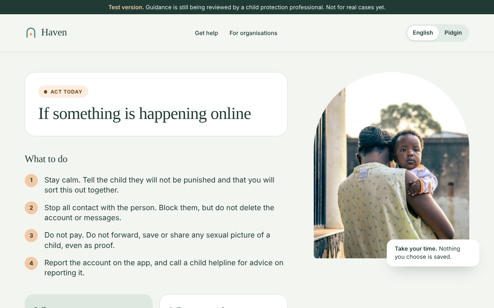
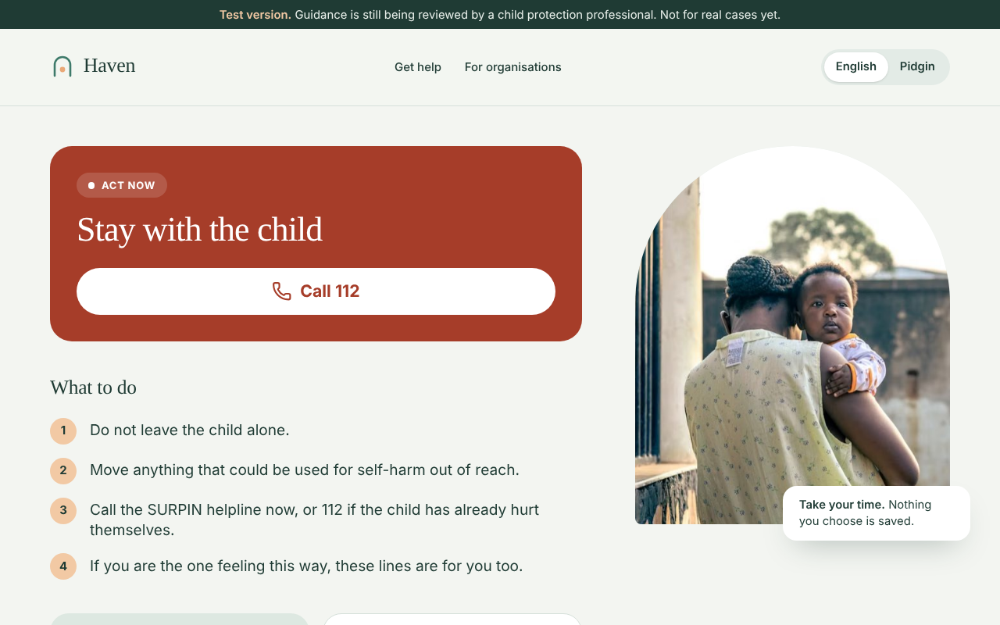
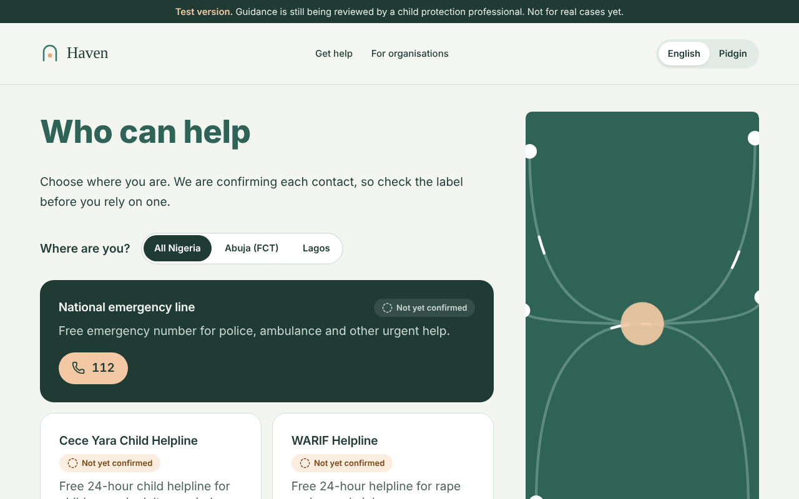
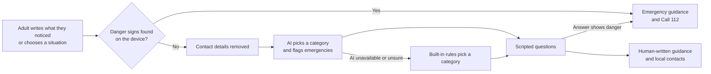

# Haven

**When an adult is worried about a child, Haven gives them the next safe step.**

Haven is a free web app for mothers, caregivers, teachers, youth leaders and community health workers in Nigeria. An adult says what they noticed, answers a few scripted questions, and gets clear guidance: what to do, what to say to the child, what to avoid, and who can help nearby. Danger signs skip straight to emergency help.

A child does not need a phone or internet access for Haven to help. It supports the trusted adults already around her.

- **Live app:** [haven-for-you-teal.vercel.app](https://haven-for-you-teal.vercel.app/)
- **Pitch video:** [youtu.be/A5FYHpfK_Ic](https://youtu.be/A5FYHpfK_Ic)
- **Privacy notice:** [Google Doc](https://docs.google.com/document/d/1Jkdt7rfC2bO1h-DHmiKHYJHt04hko6l7Rx0yKkbtOtI/edit?usp=sharing)
- **Languages:** English and Nigerian Pidgin

> **Status: test version.** The guidance is drawn from published sources and is pending review by a child protection professional. Do not use it for a real case. See [docs/content-review.md](docs/content-review.md).





| Scripted questions | Guidance |
| --- | --- |
|  |  |
| **Emergency fast path** | **Who can help** |
|  |  |

## Try it in two minutes

Use only made-up text. Haven is a test version and must not receive real cases.

| Type or choose this | Answer | You should see |
| --- | --- | --- |
| "A man keeps messaging her online and says he will share her pictures unless she sends money." | No, Yes, No | **Act today**, with steps for something happening online |
| "She said she wants to die" | None | **Act now: Stay with the child**, with no questions first |
| "Omo mi wa ninu ewu" (Yoruba: "my child is in danger") | None | **Get help now**, found by the AI because the built-in rules don't cover Yoruba |
| **Something feels wrong**, then **A child has changed** | No, No, No | **Act this week**, with gentle steps for talking to the child |
| **A child is in danger now** button | None | **Get help now**, with a Call 112 button |

Switch to **Pidgin** at the top of any page. Open **Who can help** and choose Abuja or Lagos to see local services.

## Why Haven

Most abuse of children stays hidden. The first person to notice is usually a mother, teacher or health worker, and they rarely know how to respond safely. A wrong first response, such as confronting the abuser or blaming the child, can put her at greater risk.

- Nigeria has [52 sexual assault referral centres across 25 states and the FCT](https://gazettengr.com/unicef-study-warns-of-rising-online-sexual-abuse-risks-for-nigerian-children/), but stigma and underreporting keep many survivors away.
- At one Abuja centre, [84% of 345 cases from 2020 to 2024 involved children under 18](https://childreninfobank.com/?p=37339).
- In a Nigerian Communications Commission study, [93% of 11 to 16-year-olds went online by mobile phone](https://leadership.ng/protecting-nigerian-children-from-cyber-risks-pandemic), so online risks reach children at home.

Help exists, but adults struggle to reach it. Haven connects the moment someone notices with the help that already exists.

## How it works



1. **Describe or choose.** An adult writes what they noticed, or picks the closest situation.
2. **Check for danger first.** Rules on the adult's device look for danger signs. If they find one, Haven shows emergency help at once and sends nothing anywhere.
3. **Route safely.** Otherwise, Haven removes phone numbers and email addresses, and the AI picks one of six categories. If the AI is down, slow or unsure, the built-in rules decide.
4. **Ask before advising.** Two or three scripted questions set the urgency: act now, today or this week.
5. **Guide.** Haven shows reviewed guidance in English or Pidgin, and contacts for the adult's area.

## What the AI does, and what it can't do

| The AI can | The AI can't |
| --- | --- |
| Read informal writing, Pidgin and some Yoruba | Write advice or speak to the user |
| Choose one of six categories | Change any word of guidance |
| Flag an emergency, including one the rules missed | Clear an emergency the rules found |
| Say it is unsure, so the rules take over | See images, names, phone numbers or email addresses |

The model is Google Gemini, called from the server. It may return only fixed labels. Anything else is thrown away, and Haven falls back to its rules.

## Safety by design

- **People write every word of advice.** All guidance lives in [`src/content/guidance.ts`](src/content/guidance.ts), with its sources listed in the app.
- **Haven works without AI.** The rules in [`src/lib/triage.ts`](src/lib/triage.ts) and the scripted questions route people safely on their own.
- **Emergencies can't be downgraded.** AI can raise a concern to an emergency, but never clear one.
- **No images, ever.** Haven has no upload path, and a test fails if one is added.
- **Nothing kept.** Haven has no database of concerns and doesn't log what people write. Optional accounts hold profile details only and are never linked to a concern.
- **No account needed.** Accounts are optional, for individual frontline workers and organisations aged 18 or over.
- **Honest contacts.** Each contact shows "Not yet confirmed" until the team has called it.

## Evidence so far

**Automated tests:** 51 tests run with `bun run test`. They check that:

- emergency wording in English and Pidgin is caught without AI
- the AI can raise an emergency but never clear one
- text from the AI can never reach the screen
- phone numbers and email addresses are removed before text leaves the device
- what people write is never logged
- every guidance line exists in English and Pidgin, with a source and contacts in every area
- the app contains no image or file upload

**Testing with adults:** we are testing with adults using only made-up scenarios. We will add the results here.

## Cost to run

Haven asks the AI only to choose a label, so each request is small. Based on Google's published prices, we estimate the AI step costs roughly **$0.30 to $1 per 1,000 concerns**, depending on the model. Hosting and accounts run on free or low-cost tiers. Each server instance is limited to 30 AI requests a minute, so costs cannot run away.

## What we need before a pilot

1. A child protection professional reviews all guidance and emergency rules.
2. Native speakers check all the Pidgin.
3. The team calls every referral contact and records the date it was confirmed.
4. A privacy and security review.
5. A supervised pilot agreed with a school, health programme or referral centre.

## Limitations

- **Content review:** the guidance has not yet been reviewed by a child protection professional.
- **Contacts:** none of the 10 contacts has been confirmed by phone yet.
- **Directory:** it covers national services, Abuja and Lagos only.
- **Languages:** guidance is in English and Pidgin only. The AI can understand some Yoruba, but Haven doesn't yet offer Yoruba or Hausa guidance.
- **Rules:** the built-in rules match English and Pidgin wording. Other languages depend on the AI.
- **Video:** the home page video uses about 1.2 MB of data on first load.

## Roadmap

| When | Goal |
| --- | --- |
| Months 1 to 3 | Secure a child protection partner, complete expert review, confirm every contact |
| Months 4 to 6 | Supervised pilot with about 100 adults in three states |
| Months 7 to 9 | Yoruba and Hausa guidance written by native speakers, and low-bandwidth voice input |
| Months 10 to 12 | Publish pilot results, cover more states, seek adoption by a state or national programme |

See [roadmap.md](roadmap.md) for the detailed checklist.

## Run it

You need [Bun](https://bun.sh) installed.

```sh
bun install
cp .env.example .env
bun run dev
bun run test
npx tsc --noEmit
```

Without `GEMINI_API_KEY`, Haven uses its rules. Without the Supabase values, accounts are off, but getting help still works.

### Where things live

| Path | What it holds |
| --- | --- |
| `src/content/guidance.ts` | Questions and guidance, in English and Pidgin |
| `src/content/contacts.ts` | Referral directory, with each contact's source and confirmation date |
| `src/lib/triage.ts` | Emergency rules, category rules and checks on AI output |
| `src/lib/route-concern.server.ts` | The AI request and its spending cap |
| `src/components/haven/` | The intake, question, guidance and contact screens |
| `docs/content-review.md` | Notes for the professional reviewing the guidance |

### Deploy to Vercel

1. Create a Supabase project. Haven needs no tables, because account details are stored in Supabase Auth.
2. In Supabase, set the Site URL to your Vercel address, and add `<your address>/**` to the redirect URLs.
3. Create a Gemini API key with billing turned on. Google's free tier must not receive sensitive information.
4. Import this repository at vercel.com/new and keep the TanStack Start preset.
5. Add every variable in `.env.example`, then deploy. `GEMINI_MODEL` is optional.

## Built with

TanStack Start, React and Tailwind CSS, hosted on Vercel. Accounts use Supabase Auth, and AI routing uses Google Gemini.

## Licence

Code is released under the [MIT licence](LICENSE). Haven's own guidance text is released under [CC BY 4.0](https://creativecommons.org/licenses/by/4.0/). Published sources belong to their authors and are listed in the app.
